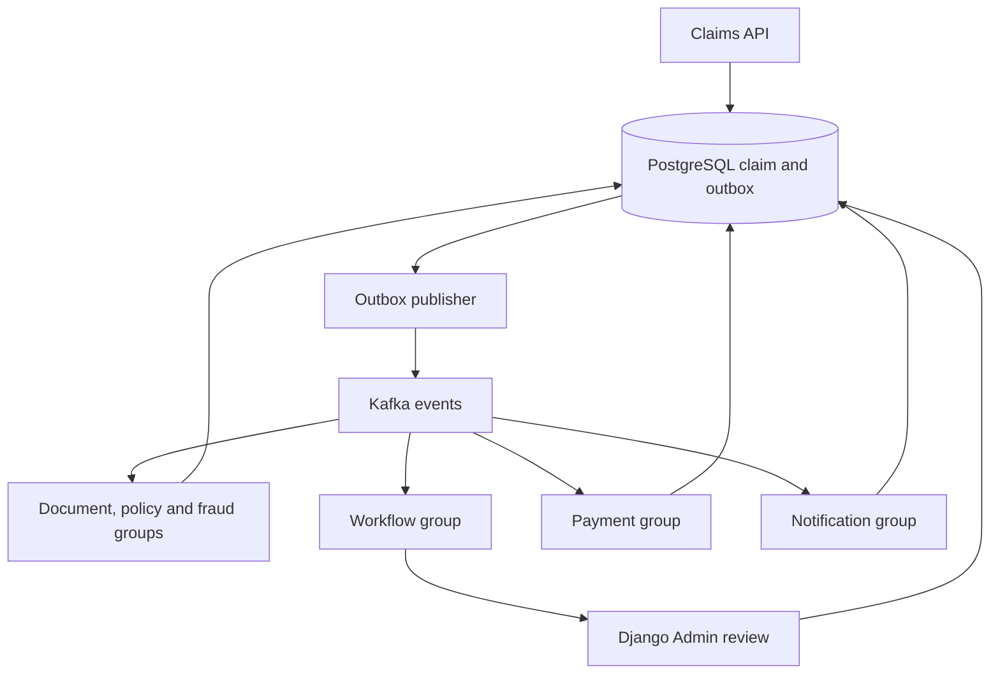

# ClaimFlow

Event-driven insurance claims backend: a modular Django application, PostgreSQL system of record, and independent Kafka worker processes. Django Admin is the initial review interface. No custom frontend is included.

## Run locally

Requires Docker Engine / Desktop with Compose v2. On Windows, enable Docker Desktop's WSL2 backend. The complete stack is sizeable; on an 8 GB laptop start infrastructure and workers in small groups and leave monitoring stopped until needed.

```bash
cp .env.example .env
# Replace the example secrets in .env; this file is ignored by git.
docker compose up --build -d
docker compose exec web python manage.py createsuperuser
```

Open http://localhost:8000/admin/ for users, policies, claim review and audit records. Open http://localhost:3000 for the read-only Grafana dashboard, http://localhost:9090 for Prometheus and http://localhost:9001 for object storage administration. All host ports bind to loopback. Compose runs Django's development server so Admin static assets work immediately; the image's default command is Gunicorn for deployment behind a static-file server and TLS proxy.

Migrations, Kafka topics (six partitions), and the private document bucket are created by one-shot setup services. If setup fails, inspect `docker compose logs migrate topics bucket` before restarting dependent services. A single Kafka broker with replication factor one is for local development only.

Create an ordinary customer and a policy in Admin. Set policy dates and coverage. Issue a customer API token through the management command (keep the token private):

```bash
docker compose exec web python manage.py drf_create_token CUSTOMER_USERNAME
```

Use that token below. Document upload returns a UUID. Submission requires at least one owned, unattached document.

```bash
curl -H "Authorization: Token YOUR_TOKEN" -F "file=@receipt.pdf" http://localhost:8000/api/documents
curl -H "Authorization: Token YOUR_TOKEN" -H "Idempotency-Key: claim-request-001" -H "Content-Type: application/json" -d '{"policy_reference":"POL-001","amount":"100.00","incident_date":"2026-11-01","description":"Hospital expenses after an accident","document_ids":["DOCUMENT_UUID"]}' http://localhost:8000/api/claims
curl -H "Authorization: Token YOUR_TOKEN" http://localhost:8000/api/claims/CLAIM_UUID
```

PowerShell users can use `curl.exe` or `Invoke-RestMethod` and adapt quoting. The incident date must not be in the future and should fall within policy coverage.

## APIs

| Method | Route | Behavior |
|---|---|---|
| POST | `/api/documents` | Private PDF upload, 10 MiB maximum; returns ID and digest |
| GET | `/api/documents/{uuid}` | Streams PDF for owner or authorized staff reviewer |
| POST | `/api/claims` | Validates input; atomically saves claim, document links and outbox |
| GET | `/api/claims` | Paginated claims owned by current customer |
| GET | `/api/claims/{uuid}` | Owned claim and verification results |
| GET | `/health/live` | Process liveness |
| GET | `/health/ready` | Database and Redis readiness; Kafka outages do not block durable submissions |
| GET | `/metrics` | Prometheus metrics; restrict at ingress outside local development |

Authentication uses DRF tokens or Django sessions with CSRF enforcement. No public registration or token issuance endpoint is exposed. Tokens need HTTPS outside localhost. No client-supplied owner is accepted. Submission keys are scoped to the customer: identical retry returns HTTP 200; changed input returns 409; new claim returns 201. Invalid input returns 400; authentication 401; another customer's resource 404. Redis backs a shared 120/minute per-user application throttle; place stronger abuse controls at ingress for hostile traffic.

## Processing and reliability



- `claims`: submission, document ownership, transitions and manual decision audit.
- `policies`: customer policy and coverage data; checked against current policy state during processing.
- `verification`: independent document, policy and fraud results.
- `payments`: payment reservation, provider key and settlement reconciliation.
- `notifications`: durable in-app notification records (delivery adapters are not configured).
- `common`: durable outbox/inbox, event validation, worker commands, dead letters and telemetry.

The publisher selects one due outbox row with `SELECT FOR UPDATE SKIP LOCKED`, sends with claim UUID as key, waits for broker acknowledgment, then marks publication. A crash after broker ack can duplicate an event. Delivery is **at least once**, not end-to-end exactly once. Failed publishes retain the row and retry indefinitely with capped exponential backoff and jitter; operators must alert on persistent failures. One row per delivery is intentionally simple; batch publishing is an optimization for measured throughput needs.

Each consumer role has its own group. Results and `(consumer, event_id)` inbox entries commit together under the claim row lock. Offset commit is synchronous and follows DB success. The payment provider call runs outside the local transaction; its stable `claim:{uuid}` key and reconciliation bridge the external side-effect gap. There are no consumers in app startup, signals or web-server hooks.

Ordering is scoped by claim key at Kafka, but concurrent outbox publishers/retries can reorder publication. Workflow handlers therefore read all durable check results and tolerate duplicate/out-of-order completion events. Topic publishers must be trusted: broker ACLs define the event trust boundary, while payloads are still schema-validated. A compromised publisher can spoof lifecycle events; this starter is not a cryptographically authenticated event bus.

Worker handling has four attempts with backoff for unexpected processing errors. Invalid payloads go straight to dead-letter handling. Database connectivity failures stop the worker without committing offsets; the supervisor restarts it. DLQ metadata must be acknowledged before source offset commit. Raw payloads remain only in restricted database records; DLQ metadata excludes claim documents and descriptions. SIGTERM drains the current message and closes the consumer. Scale a role with `docker compose up -d --scale document=2`; each role has six useful partition consumers before adding partitions. Database capacity remains shared.

## Demo behavior and extension points

**No real insurance decision model or money transfer is configured.** Policy coverage is a real deterministic check. Document verification checks presence only, not content validity or malware. Fraud verification always requests human review. A valid claim therefore reaches `manual_review`; staff with `claims.change_claim` select approve/reject in Admin. Invalid coverage reaches `rejected`. Approved claims settle through a durable **demo provider ledger**, then produce an in-app notification.

Before connecting a real provider, implement a bounded-timeout provider adapter with idempotent create/lookup semantics using the existing payment key. Reconciliation must query that provider after ambiguous timeouts before creating any replacement payment. Schedule `reconcile_payments` with an external scheduler. Add authenticated provider callbacks if required, with signature/replay validation.

PDF magic-byte validation is an initial boundary only. Uploaded documents are untrusted and served as attachments. Add malware scanning/quarantine, content extraction, retention rules and orphan-object cleanup before accepting real customer documents. File storage and DB cannot commit atomically; a failed DB write can leave an unreferenced object. Review actions record identity and timestamp with a fixed reason; add a reason-entry form and tamper-resistant audit storage for stricter audit requirements.

## Operations

```bash
docker compose logs -f outbox workflow payment
docker compose exec web python manage.py reconcile_payments
docker compose exec web python manage.py replay_dead_letter DEAD_LETTER_ID
```

Restrict replay to operators with shell and DB access. Inspect the failure, repair the underlying cause, and replay into the original role with the original event ID. Inbox deduplication makes retries safe. Malformed payloads require an audited correction outside this command; do not blindly resend poison events. Replays already marked successful are refused. Store and retain raw dead letters according to document privacy requirements.

Monitor event outcome rates, worker availability, processing duration, publisher retries, Kafka consumer lag and pending outbox age. The included dashboard and alerts cover the first four; Kafka lag and outbox-age collection are future additions. OTLP spans propagate traceparent through the outbox and consumers; the local collector logs basic span metadata. Configure a retained tracing backend for production. Prometheus is configured with alert rules; Alertmanager delivery is not configured. HTTP metrics use a single Gunicorn worker by default; configure Prometheus multiprocess support before increasing Gunicorn worker count.

Production needs TLS ingress, restricted Admin/metrics, broker SASL_SSL and per-role ACLs, private bucket credentials, least-privilege database users, replicated Kafka (typically RF3/min ISR2), managed database backups/PITR and tested restore procedures. Set DEBUG=false, configure secure hosts and cookies, serve static assets separately, and establish measured SLO/RPO/RTO targets. No throughput or compliance claim is made. Do not expose the local monitoring or object-store admin services publicly.

Initial migrations only add schema to an empty application; review locking and mixed-version compatibility for future changes. Never delete outbox or inbox history without a retention/replay policy: pruning inbox entries permits old events to execute again. Back up DB and object storage together, restore in isolation, verify claims/document references, reconcile provider state, and replay unpublished outbox rows before reopening writes.

## Development and verification

```bash
python -m venv .venv
# Windows: .venv\Scripts\activate
# Linux/macOS: source .venv/bin/activate
pip install -r requirements-dev.lock
TESTING=1 pytest -q
TESTING=1 python manage.py check
TESTING=1 python manage.py makemigrations --check --dry-run
ruff check .
ruff format --check .
```

In PowerShell set `$env:TESTING="1"` before commands. Tests use SQLite by default for portability. To verify PostgreSQL locking and concurrency, run against a disposable PostgreSQL database with TESTING=1, TEST_POSTGRES=1 and POSTGRES_* configured. CI does this and includes the concurrent submission test. Never point test settings at production. TESTING is a test-only mode and must not be set in deployed services.

See `VERIFICATION.md` for checks actually executed in the build environment and their limitations. `requirements.lock` and `requirements-dev.lock` record the tested resolved dependency versions; regenerate deliberately when updating dependencies.

Architecture decision: begin with one database and modular Django code, because claim transitions and outbox consistency benefit from local transactions. Keep independent worker deployments for differing processing load. Extract a service when operational ownership, isolation or independent persistence requirements justify the added network consistency costs.

Primary references: [Django transactions](https://docs.djangoproject.com/en/5.2/topics/db/transactions/) and [Confluent Python client](https://docs.confluent.io/kafka-clients/python/current/overview.html).

## RAG claim verification

See [RAG setup and limitations](docs/RAG.md) for policy ingestion, Docker configuration, cited findings, and manual-review behavior.
